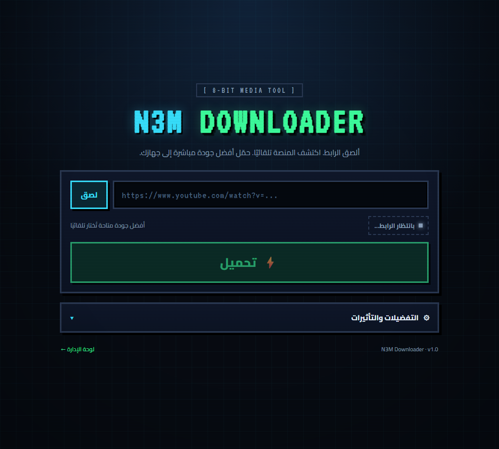

# N3M Downloader

> أداة تحميل وسائط شخصية بهوية **8-بت** عربية: ألصق الرابط، اكتشف المنصة تلقائيًا، وحمّل أفضل جودة مباشرة إلى جهازك.



- **الواجهة:** Next.js 15 (App Router) + TypeScript + تصدير ثابت (Static Export) لـ Cloudflare Pages.
- **المحرك:** FastAPI + Python 3.12 + yt-dlp + gallery-dl + aria2c + FFmpeg.
- **الإدارة:** `/admin/` محمية برمز `ADMIN_TOKEN`.
- **اللغة:** عربية RTL بالكامل، مع مؤثرات صوتية 8-بت وفلتر CRT اختياري.

---

## الميزات

| الميزة | التفاصيل |
|---|---|
| اكتشاف المنصة | YouTube، TikTok، Instagram، X، SoundCloud، Pinterest، Reddit، Vimeo، والملفات المباشرة |
| اختيار الجودة | أفضل جودة تلقائيًا، أو 1080p / 720p / صوت MP3 يدويًا |
| تقدم حي | نسبة مئوية، سرعة النقل، الوقت المتبقي، والحجم (SSE مع Polling احتياطي) |
| حفظ فوري | تذكرة تحميل موقعة تُسلّم الملف مباشرة للمتصفح |
| تفضيلات | صوت، CRT، الجودة، وسجل آخر 10 تنزيلات في `localStorage` |
| أمان | Trusted Origin، تحديد معدل، تذاكر HMAC، حماية SSRF، وحارس مساحة |
| إدارة | حالة المحركات الأربعة، المعالج، التخزين، حدود الحماية، وتنظيف الملفات |

## البنية

```text
n3m-downloader/
├── backend/                 FastAPI engine
│   ├── app/
│   │   ├── main.py          HTTP routes, auth, SSE, admin
│   │   ├── jobs.py          in-memory jobs, progress, cancellation, cleanup
│   │   ├── ssrf.py          public-URL validation + safe HEAD
│   │   ├── tickets.py       HMAC-SHA256 download tickets
│   │   ├── rate_limit.py    sliding-window limiter
│   │   ├── storage.py       safe names, quota, zip, retention
│   │   └── engines/         yt-dlp, gallery-dl, direct/aria2c, ffmpeg probe
│   ├── tests/               63 pytest tests
│   ├── Dockerfile           Render image (ffmpeg + aria2)
│   └── start_server.bat     local one-click launcher
├── frontend/                Next.js static UI
│   ├── app/                 layout, home, /admin
│   ├── components/          Downloader, progress, preferences, admin
│   ├── lib/                 API client, platforms, format, prefs, history
│   ├── tests/               46 Vitest tests
│   └── out/                 generated static export
├── docs/API.md              endpoint contract
├── docs/SECURITY.md         threat model and checklist
├── render.yaml              Render blueprint
└── .github/workflows/       CI + Render heartbeat
```

## تشغيل سريع (محلي)

**الطريقة الأسهل — نقرة مزدوجة:** `start_all.bat` في جذر المشروع. يفتح نافذتين: المحرك على `8765` والواجهة على `3000`، ثم يفتح المتصفح.

المتطلبات:

- Windows وNode.js 20+ (مثبت على هذا الجهاز).
- Python 3.12+ لإنشاء `.venv` أول مرة فقط. إذا كان `backend/.venv` موجودًا — كما في هذه النسخة — فلا حاجة لـ Python على PATH.
- لا حاجة لـ `pnpm`؛ المشغّلات تستخدم Node مباشرة.

### 1) المحرك

**Windows — نقرة مزدوجة:** `backend/start_server.bat`

يستخدم البيئة الافتراضية إن وُجدت، يثبّت الاعتماديات عند الحاجة، ينشئ `backend/.env` بمفاتيح عشوائية، ويطبع رمز الإدارة، ثم يبدأ على `http://127.0.0.1:8765`.

يدويًا:

```powershell
cd backend
if (!(Test-Path .venv)) { python -m venv .venv }
.\.venv\Scripts\python.exe -m pip install -r requirements.txt
.\.venv\Scripts\python.exe bootstrap.py
.\.venv\Scripts\python.exe -m uvicorn app.main:app --host 127.0.0.1 --port 8765
```

يتطلب `FFmpeg` لدمج الفيديو/استخراج MP3، و`aria2c` لتسريع الملفات المباشرة. بدونهما يعمل المحرك بجودة أقل وبسرعة عادية.

### 2) الواجهة

**Windows — نقرة مزدوجة:** `frontend/start_dev.bat`

أو يدويًا:

```powershell
cd frontend
if (!(Test-Path node_modules\next)) { npm install }
node node_modules\next\dist\bin\next dev -p 3000
```

- الأداة: `http://localhost:3000`
- الإدارة: `http://localhost:3000/admin/` (استخدم `ADMIN_TOKEN` من `backend/.env`)

### إن لم تعمل الصفحة

- شغّل `start_all.bat` وانتظر ظهور `Ready` في نافذة الواجهة و`Application startup complete` في نافذة المحرك.
- لا تغلق نافذة المحرك أثناء الاستخدام؛ إغلاقها يوقف التحميل.
- افتح `http://localhost:3000` مباشرة، لا ملف HTML من المجلد.
- فحص سريع: `http://127.0.0.1:8765/health` يجب أن يعيد `{"status":"ok"}`.
- رمز الإدارة موجود في `backend/.env` ضمن `ADMIN_TOKEN`.

### 3) بناء الإنتاج

```powershell
cd frontend
pnpm build     # ينتج مجلد out/ الجاهز للرفع
```

## الاختبارات

```powershell
# الخلفية (63 اختبارًا: SSRF، تذاكر، معدل، مصادقة، مهام، تنظيف)
cd backend
.\.venv\Scripts\python.exe -m pytest

# الواجهة (46 اختبارًا: اكتشاف المنصات، التنسيق، السجل، التفضيلات، عميل API)
frontend\test.bat

# التحقق من الأنواع + بناء ثابت
frontend\build.bat
```

> على Windows داخل بيئة مقيّدة قد تحتاج اختبارات الواجهة والبناء إلى تشغيل خارج الـ sandbox لأن Next/Vitest يشغّلان عمليات فرعية.

## النسخة المنشورة

| الجزء | الرابط |
|---|---|
| الأداة | <https://n3m.fun/downloader/> |
| لوحة الإدارة | <https://n3m.fun/downloader/admin/> |
| المحرك | <https://n3m-downloader-engine.onrender.com> |
| المصدر | <https://github.com/N3M-l/n3m-downloader> |

- الواجهة تعمل على **Cloudflare Worker** مربوط بمسار `n3m.fun/downloader/*`، مع أصول Next.js الثابتة داخل نفس الـ Worker.
- المحرك يعمل على **Render** (Docker + FFmpeg + aria2c)، ويُبقي Worker's Cron Trigger الخدمة مستيقظة كل 5 دقائق.
- `BACKEND/.env` المحلي غير منشور. رمز الإدارة الإنتاجي محفوظ في `_backups/n3m-render-env.txt` على هذا الجهاز، ويمكن استبداله من Render.
- النطاق الفرعي `downloader.n3m.fun` لم يُربط بعد لأن صلاحية OAuth الحالية لا تسمح بإنشاء سجل DNS؛ الرابط الرسمي الحالي هو المسار `/downloader/`.

## الإعدادات

كل إعدادات المحرك عبر متغيرات البيئة، ويمكن وضعها في `backend/.env`. راجع [`backend/.env.example`](backend/.env.example).

| المتغير | الافتراضي | المعنى |
|---|---|---|
| `N3M_ENV` | `development` | `production` يفرض وجود الأسرار |
| `ADMIN_TOKEN` | مُولّد محليًا | رمز لوحة الإدارة (Bearer) |
| `TICKET_SECRET` | مُولّد محليًا | مفتاح توقيع تذاكر التحميل |
| `TRUSTED_ORIGINS` | `https://n3m.fun,...` | أصول المتصفح المسموح لها |
| `INSPECT_RATE_PER_MIN` | `30` | حد الفحص لكل IP |
| `DOWNLOAD_RATE_PER_MIN` | `6` | حد بدء التنزيل لكل IP |
| `MAX_CONCURRENT_JOBS` | `2` | مهام متزامنة |
| `MAX_QUEUED_JOBS` | `20` | أقصى طابور |
| `MAX_FILESIZE_MB` | `2048` | أقصى حجم ملف |
| `MIN_FREE_GB` | `2` | الحد الآمن للمساحة الحرة |
| `TICKET_TTL_SECONDS` | `300` | صلاحية رابط التحميل |
| `JOB_TIMEOUT_SECONDS` | `1800` | مهلة المهمة |
| `JOB_RETENTION_MINUTES` | `120` | عمر الملفات المؤقتة |

## النشر

### المحرك — Render (Docker)

1. الخدمة `n3m-downloader-engine` مرتبطة بمستودع GitHub وفرع `master`، وجذر البناء `backend`.
2. الإعدادات الإنتاجية مضبوطة في Render: `N3M_ENV=production`، `ADMIN_TOKEN`، `TICKET_SECRET`، `TRUSTED_ORIGINS`، وحدود الحجم.
3. نقطة الفحص: `/health`، والنشر التلقائي مفعّل عند كل push إلى `master`.

> الخطة المجانية تستخدم قرصًا مؤقتًا: الملفات تُحذف عند إعادة النشر أو إعادة التشغيل. التنظيف الدوري يمنع امتلاء القرص أثناء التشغيل.

### الواجهة — Cloudflare Worker

- الملف: `frontend/wrangler.jsonc` + `frontend/worker/worker.mjs`.
- البناء:
  ```powershell
  cd frontend
  $env:NEXT_PUBLIC_BASE_PATH='/downloader'
  $env:NEXT_PUBLIC_ENGINE_URL='https://n3m-downloader-engine.onrender.com'
  npm run build
  npx wrangler deploy
  ```
- الـ Worker يخدم `/downloader/` و`/downloader/admin/` ويضيف رؤوس CSP والأمان، ويحتفظ بجدولة كل 5 دقائق لإيقاظ Render.
- `frontend/public/_headers` يبقى لاستخدام Pages إن أردت النشر هناك لاحقًا.

### منع خمول Render

- **Cloudflare Cron Trigger:** `*/5 * * * *` داخل `frontend/wrangler.jsonc` يطلب `/health` تلقائيًا.
- **GitHub Actions:** `.github/workflows/heartbeat.yml` كل 10 دقائق كطبقة احتياطية.

## الأمان

- **Trusted Origin:** كل `/api/*` يتطلب `Origin` مسموحًا، عدا رابط التحميل الموقّع و`/health`.
- **تذاكر قصيرة:** HMAC-SHA256، صلاحية 5 دقائق، مرتبطة بالمهمة؛ المسار يأتي من سجل المهام لا من التذكرة.
- **SSRF:** رفض غير HTTP(S)، بيانات الدخول، المنافذ غير 80/443، والعناوين الخاصة/المحلية/الروابط الوصفية بعد حل DNS.
- **تحديد المعدل:** نافذة منزلقة لكل IP (30 فحصًا و6 تنزيلات في الدقيقة).
- **الحصة:** فحص المساحة قبل البدء وأثناء البث، وتنظيف تلقائي للملفات القديمة.
- **الأسرار:** لا تُطبع في السجلات، و`.env` و`_backups` مستبعدة من git.

راجع [`docs/SECURITY.md`](docs/SECURITY.md) للتفاصيل والقيود المعروفة.

## واجهة API

راجع [`docs/API.md`](docs/API.md). باختصار:

```text
POST /api/inspect            → بيانات الرابط والمنصات والصيغ
POST /api/download           → { jobId, pollUrl, eventsUrl }
GET  /api/jobs/{id}          → الحالة + downloadPath عند الاكتمال
GET  /api/jobs/{id}/events   → SSE للتقدم
GET  /api/download/{token}   → الملف (Content-Disposition: attachment)
GET  /api/admin/status       → إحصاءات كاملة (Bearer)
POST /api/admin/cleanup      → تنظيف فوري (Bearer)
```

## نقاط الاستعادة

- **Git tag:** `backup-pre-release-v1.0.0`
- **Git branch:** `backup/pre-release-v1.0.0`
- **نسخة محلية:** `../_backups/n3m-downloader-pre-release.tar.gz` (خارج المستودع، مع Checksum)

استعادة سريعة:

```powershell
git checkout backup/pre-release-v1.0.0
# أو فك الأرشيف في مسار جديد ثم pnpm install && pip install -r requirements.txt
tar -xzf ../_backups/n3m-downloader-pre-release.tar.gz -C ../n3m-downloader-restore
```

## حدود معروفة

- بعض المنصات (Instagram/TikTok) تتغير باستمرار؛ حدّث `yt-dlp` دوريًا: `pip install -U yt-dlp`.
- لا توجد حسابات مستخدمين أو قاعدة بيانات: الحالة في الذاكرة، والملفات مؤقتة.
- أتمتة المتصفح ليست جزءًا من هذه النسخة (لا اختبارات Playwright واجهية).
- الحماية من SSRF تتحقق عند كل طلب وعند كل تحويل، لكن إعادة توجيه DNS بين التحقق والاتصال تبقى ثغرة نظرية معروفة (راجع docs/SECURITY).
- لا تُشغّل الخادم على منفذ عام بدون HTTPS وعكس وكيل يضبط `X-Forwarded-For`.

---

صُنع بهوية 8-بت. آخر تحديث: أكتوبر 2026.
